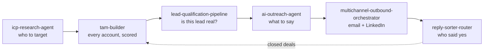

### Hi, I'm Zinkwonri 👋

```python
class Zinkwonri:
    builds   = ["data pipelines", "AI agents", "automation workflows"]
    stack    = ["Python", "Claude", "n8n", "Clay", "Node.js"]
    location = "Nigeria · remote"
    shipped  = {"meetings_booked": "300+", "interested_replies": "1,000+", "teams": "30+"}

    def approach(self):
        return "rules where you can, models where you must, a human where it matters"
```

I build systems that find the right companies, check the data before spending money on it, and act on it automatically: scoring, routing, writing, following up. Most of them run without anyone touching them. The numbers above come from what they produced.

---

### 🛠 Systems

| Repo | What it does | Built with |
|---|---|---|
| [**lead-qualification-pipeline**](https://github.com/zinkwonri-kayinu/lead-qualification-pipeline) | Deterministic checks settle the clear leads; Claude judges only the ambiguous ones → `valid` / `invalid` / `unclear` with a reason | Python · Claude API · Pydantic |
| [**multichannel-outbound-orchestrator**](https://github.com/zinkwonri-kayinu/multichannel-outbound-orchestrator) | Routes each lead to email, LinkedIn or both. Dedup, batching, 429 backoff, dry-run by default | Python · Instantly API · HeyReach API |
| [**tam-builder**](https://github.com/zinkwonri-kayinu/tam-builder) | Self-refining market map: learns which signals predict a win from closed deals, re-tiers every account, rebalances territories | Node.js · Claude Code · Clay |
| [**ai-outreach-agent**](https://github.com/zinkwonri-kayinu/ai-outreach-agent) | Email or domain in → research, best-fit offer, email + DM out. A rules engine rejects copy that breaks the style guide | Claude Code · Node.js |
| [**icp-research-agent**](https://github.com/zinkwonri-kayinu/icp-research-agent) | Works out who a company really sells to from case studies and reviews. Every trait is counted, not guessed | Claude Code · Python |
| [**n8n-workflows**](https://github.com/zinkwonri-kayinu/n8n-workflows) | Reply sorter with AI drafts and out-of-office follow-ups, Calendly → Clay → Claude meeting briefs, and a fully automated gift business | n8n · Clay · Claude |

### 🔗 How they fit together



### 🧰 Toolbox


### 📫 Elsewhere

[](https://zinkwonri.netlify.app)
[](https://www.linkedin.com/in/zinkwonri-kayinu-b19147392/)
[](https://x.com/Zkayinu)
[](mailto:zkayinu@gmail.com)
